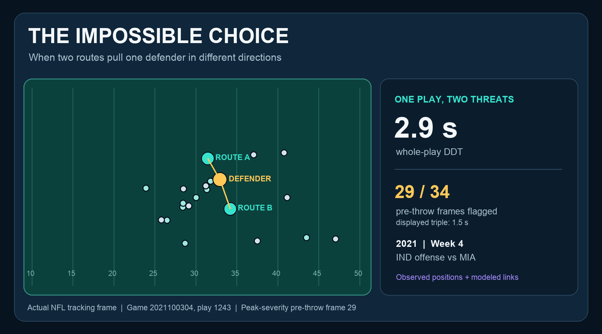

# 🏈 The Impossible Choice



**The Impossible Choice** turns a coaching question about two routes pulling one defender in different directions into **Defensive Dilemma Time (DDT)**, a pre-throw geometric metric for WR, TE, and RB routes. Using real 2021 NFL tracking at 10 frames per second, the Python tool flags moments when two diverging route runners are within one coverage defender's modeled reach and nearby geometric help is limited. In **7,578 eligible plays across 122 games**, zone plays show a higher mean DDT Rate than man plays (**23.8% versus 16.2%**); the replay exposes actual frames, a low-DDT control, and a dense counterexample for coaching review. On 25 held-out games, adding DDT to conventional geometry improved completion log loss by just **0.00032**, with a confidence interval that crosses zero, so added predictive value is unproven. Reach time is an explicit approximation and the data do not identify individual coverage assignments, making DDT a prompt for film review rather than proof of a coverage mistake.


| Explore | Verify | Reproduce |
| :--- | :--- | :--- |
| [Live actual-play replay](https://advaitnaresh.github.io/the-impossible-choice/) · [Replay source](outputs/featured_play_replay.html) · [Conflict timeline](outputs/featured_play_timeline.html) | [Finding](outputs/finding.md) · [Metric definition](METRIC.md) · [Results](outputs/baseline_comparison.csv) | [Setup and run](RUN.md) · [Analysis code](analysis.py) · [Interactive app](app.py) |

```bash
export BDB_DATA_DIR=/path/to/nfl-big-data-bowl-regional-event-data/data
python3 -m pip install -r requirements.txt
python3 analysis.py --max-games 4 --download-pbp --force
streamlit run app.py
```
