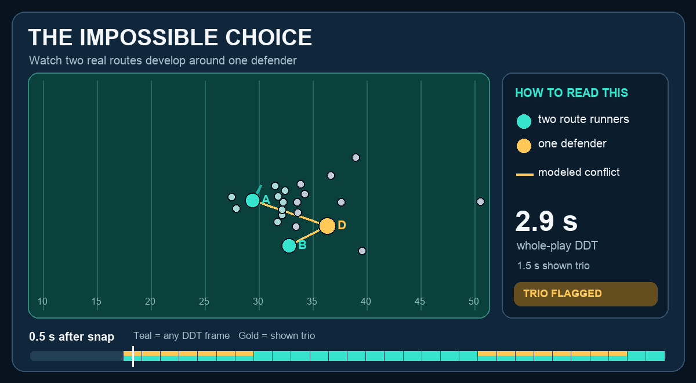
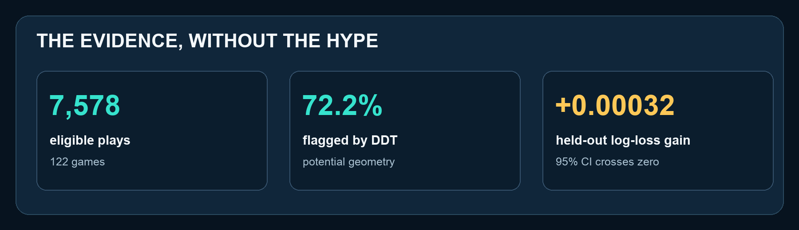

# 🏈 The Impossible Choice

**Can two routes make one defender choose?** We follow actual WR, TE, and RB routes before a throw and estimate when two diverging receivers draw the same defender into a choice with limited nearby help. We call the total time in that geometry **Defensive Dilemma Time (DDT)**. In our 2021 sample, the mean per-play DDT Rate was **23.8% for zone** versus **16.2% for man**, a descriptive pattern coaches can investigate play by play.



*Real 2021 tracking, IND vs MIA, Week 4: the teal trails are observed player movement; gold links show the modeled conflict for the displayed trio.*

**[▶ Explore the full interactive replay](https://advaitnaresh.github.io/the-impossible-choice/)** &nbsp;·&nbsp; [Read the metric definition](METRIC.md) &nbsp;·&nbsp; [Run the Python project](RUN.md)

## Read the play in 15 seconds

| What you see | What it means |
| :--- | :--- |
| **Teal A + B** | Two actual PFF-tagged route runners from the WR, TE, or RB group |
| **Gold D** | One actual PFF-tagged coverage defender |
| **Gold links** | The displayed trio meets DDT's modeled shared-reach rule at that frame |
| **Bottom timeline** | Teal marks any DDT-active frame; gold marks frames for the displayed trio |

The displayed trio qualifies for **1.5 seconds**; other qualifying trios bring this play's **whole-play DDT to 2.9 seconds** before the pass is released. DDT counts those qualifying tenth-second frames after normalizing play direction, projecting each route runner 0.4 seconds, estimating a defender's time to reach both routes, and reducing the score when another defender offers nearby geometric help.

## The football insight

Across **7,578 eligible plays from 122 games**, the tool identifies the receiver pair, defender, and exact frames behind each DDT flag. Coaches can use the [receiver-pair rankings](outputs/receiver_pair_rankings.csv) to choose concepts for film review and compare them with the replay's low-DDT and dense zero-DDT controls; broadcasters can show the route movement before the throw.



**What the result does not prove:** The 2021 data do not identify each defender's actual coverage assignment, and adding DDT to a conventional-geometry completion model produced only a **0.00032** held-out log-loss improvement with a 95% interval crossing zero. DDT is a transparent **film-review prompt for potential coverage stress**, not proof of a coverage bust, a causal route effect, or better completion prediction.

## Explore the submission

| Replay and output | Method and code |
| :--- | :--- |
| [Live replay](https://advaitnaresh.github.io/the-impossible-choice/) · [Self-contained HTML](outputs/featured_play_replay.html) · [Conflict timeline](outputs/featured_play_timeline.html) | [Metric assumptions](METRIC.md) · [Analysis](analysis.py) · [Interactive app](app.py) |
| [Finding](outputs/finding.md) · [Play-level results](outputs/ddt_play_results.csv) · [Held-out comparison](outputs/baseline_comparison.csv) | [Reproduce and inspect files](RUN.md) · [Metric implementation](metrics.py) · [Tests](tests/test_metrics.py) |

<details>
<summary><strong>Quick start with the provided tracking data</strong></summary>

```bash
export BDB_DATA_DIR=/path/to/nfl-big-data-bowl-regional-event-data/data
python3 -m pip install -r requirements.txt
python3 analysis.py --max-games 4 --download-pbp --force
streamlit run app.py
```

See [RUN.md](RUN.md) for the full 122-game reproduction path and data source.

</details>
